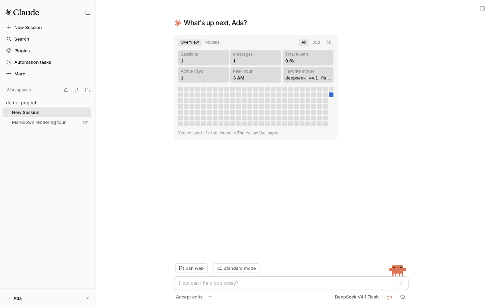
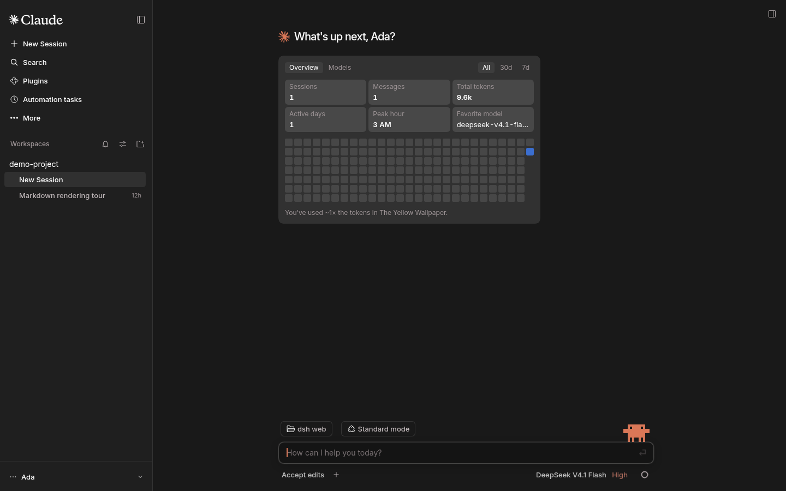
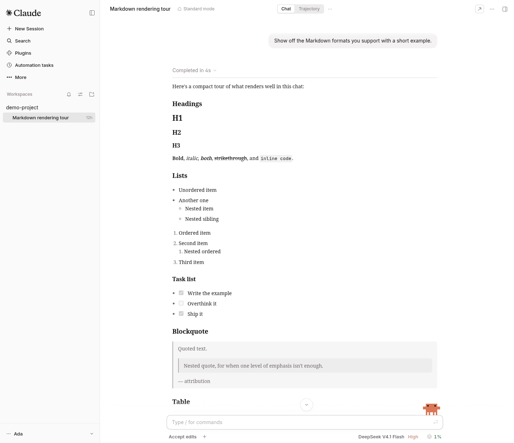
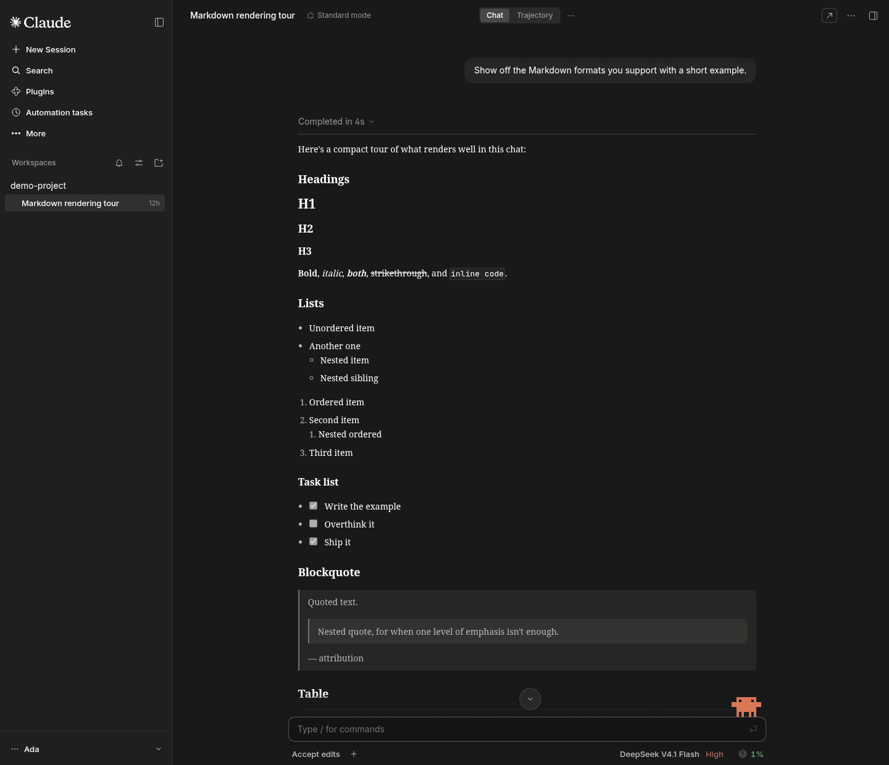
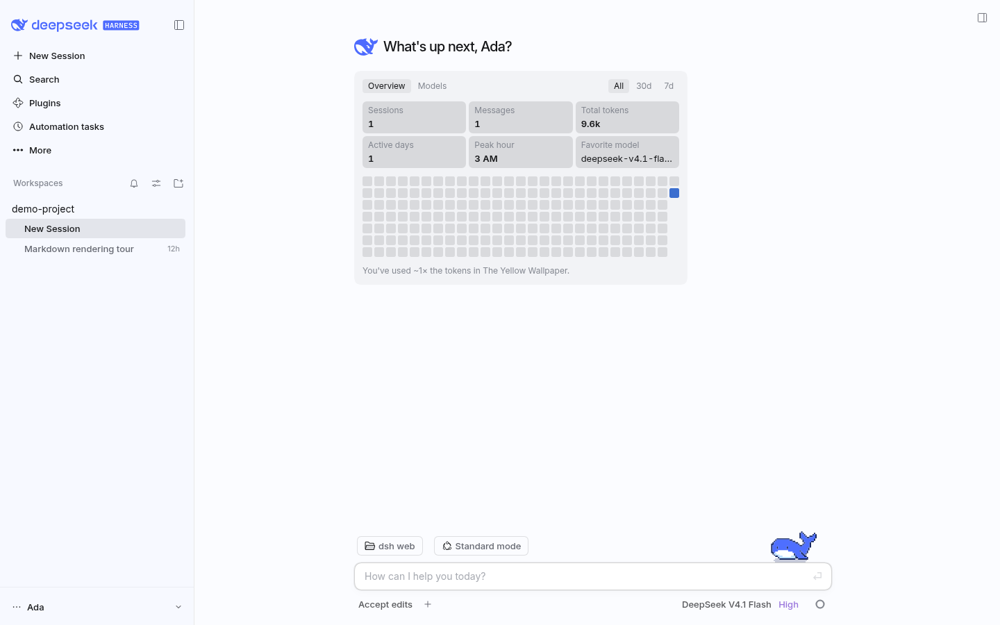
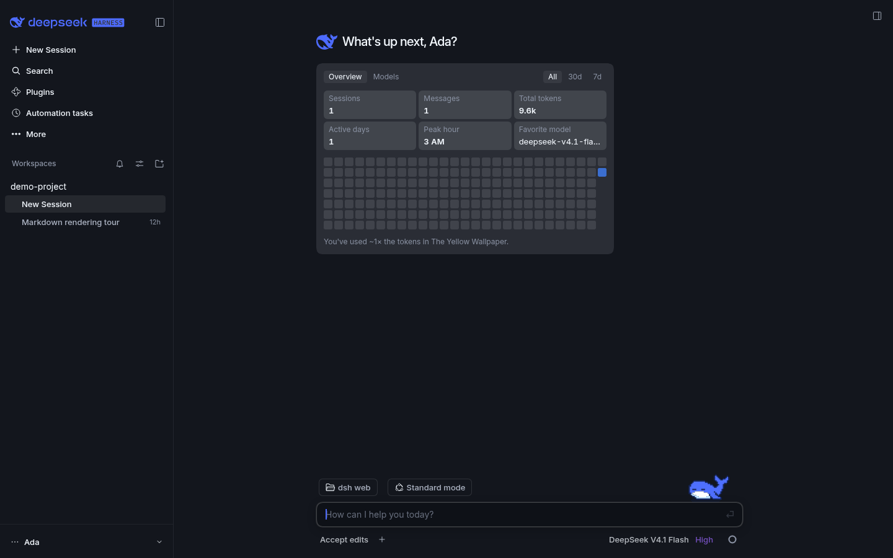
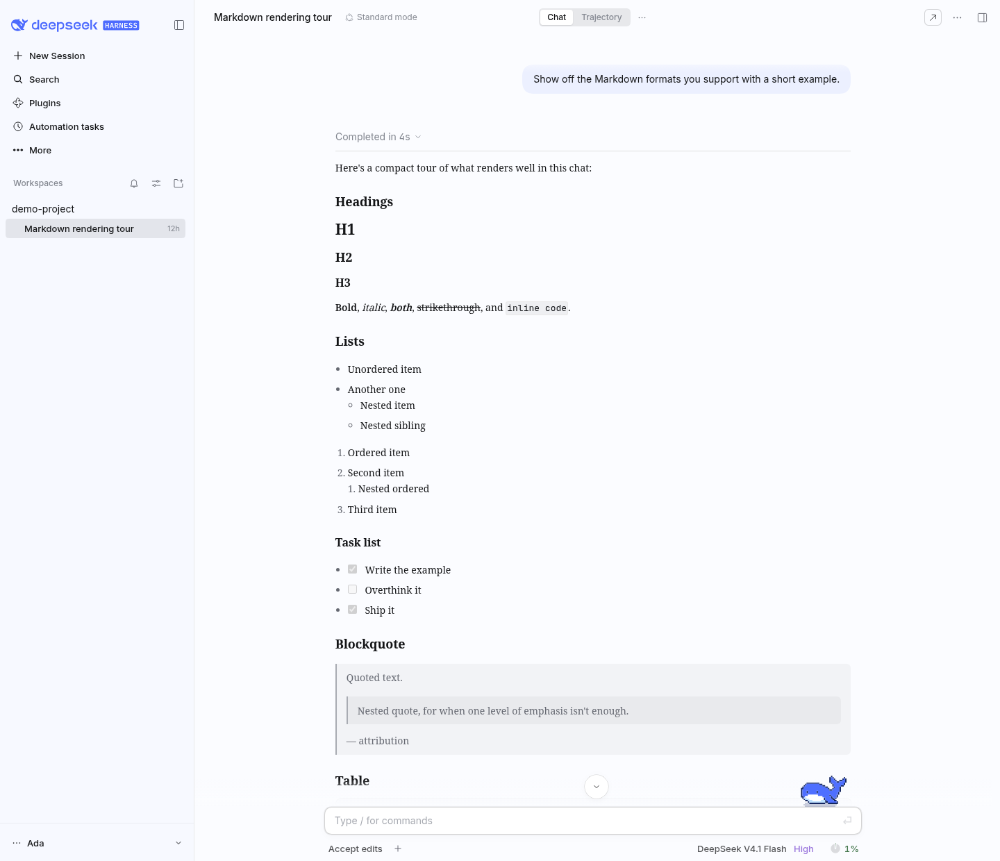
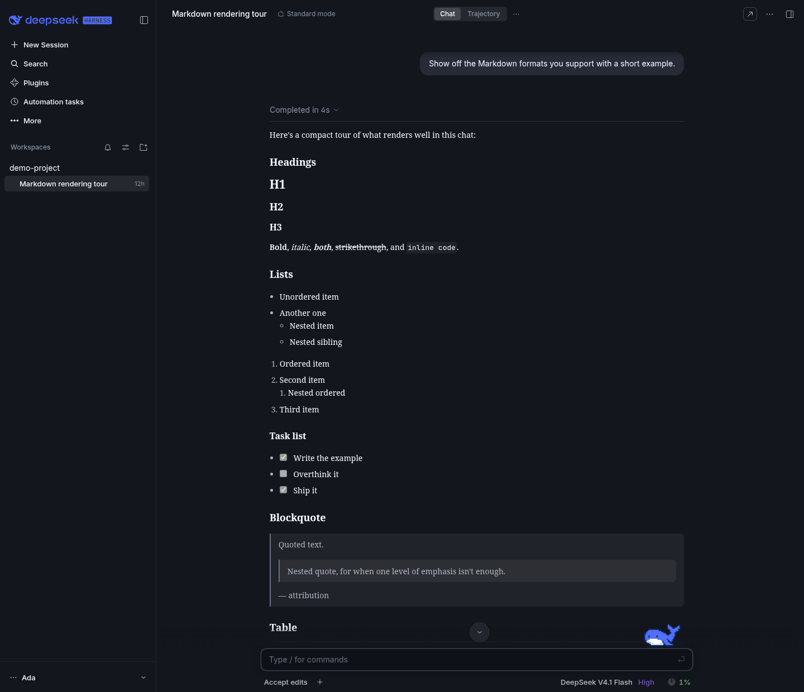

<div align="center">

# DSH Claude Style

**A theme plugin that brings the look and feel of Claude Code Desktop to the DeepSeek Harness Web GUI.**

> **Why settle for another Claude Code when your next Claude Code Desktop is here.**

[](README.md) [](README.zh.md)

[](https://github.com/martintondel02/dsh-claude-style-en/releases)
[](https://github.com/martintondel02/dsh-claude-style-en)
[](https://www.npmjs.com/package/@deepseek-ai/dsh)
[](LICENSE)

</div>

> **English edition.** This is an English-first fork of [Nwflower/dsh-claude-style](https://github.com/Nwflower/dsh-claude-style), synced with upstream v0.20.1 and verified against DeepSeek Harness 0.2.2-rc.1. The plugin has always shipped its interface copy in both English and Chinese and follows the harness language; this fork makes English the default for the README, the guides and the architecture records, and translates the source comments. Chinese is still available: see [README.zh.md](README.zh.md), and switch the harness language to `zh` to read the interface in Chinese.

## Preview

The settings page switches between the two palettes; light and dark follow the system.

### Claude

<table>
  <tr>
    <td align="center" width="50%"></td>
    <td align="center" width="50%"></td>
  </tr>
  <tr>
    <td align="center" width="50%"></td>
    <td align="center" width="50%"></td>
  </tr>
</table>

> Code home above, Markdown conversation below; light on the left, dark on the right. White canvas `#FFFFFF` with a `#FAFAFA` sidebar, near-black `#191919` with a `#1F1F1F` sidebar, ember orange `#D97757` for every action, and Claude Code's pixel crab on the composer.

### DeepSeek

<table>
  <tr>
    <td align="center" width="50%"></td>
    <td align="center" width="50%"></td>
  </tr>
  <tr>
    <td align="center" width="50%"></td>
    <td align="center" width="50%"></td>
  </tr>
</table>

> Pale blue-white canvas `#FBFCFF` with a `#F7F9FF` sidebar, blue-black `#13161D`, DeepSeek blue `#4D6BFE`; Deepy the pixel whale stands on the composer, in eight states:

<table>
  <tr>
    <td align="center" width="25%"><br />Idle</td>
    <td align="center" width="25%"><br />Thinking</td>
    <td align="center" width="25%"><br />Answering and calling tools</td>
    <td align="center" width="25%"><br />Conducting subagents</td>
  </tr>
  <tr>
    <td align="center" width="25%"><br />Waiting on you</td>
    <td align="center" width="25%"><br />Failed</td>
    <td align="center" width="25%"><br />Finished</td>
    <td align="center" width="25%"><br />Asleep</td>
  </tr>
</table>

> In Settings the mascot can also be switched to the pixel crab Clawd or the whale girl. Resting the pointer on the mascot opens a pixel bubble: the DeepSeek account balance, gifted credit included and drawn down live as the conversation spends (checked against the platform at most once a minute), on top, and under it what the current conversation has cost, the same figure the statistics line shows.

> The workspaces, sessions, usage figures and nickname in the screenshots are sample data.

## Installation

Install the fork's release branch into the web profile:

```bash
dsh plugin --profile web add martintondel02/dsh-claude-style-en#dist
```

Or clone the repository, run `npm install && npm run build`, and add the checkout:

```bash
dsh plugin --profile web add /path/to/dsh-claude-style-en
```

Keep one theme enabled at a time. The plugin needs dsh ≥ 0.2.2-rc.1; restart DeepSeek Harness after installing it so the whole feature set loads.

The package name stays `dsh-claude-style` so the fork drops in where the upstream package was configured. Remove an existing `dsh-claude-style` install first if you want to switch the plugin page and its metadata to this fork:

```bash
dsh plugin --profile web remove dsh-claude-style
```

## Manual unread marks

Choose **Mark as unread** or **Clear unread mark** from a session's ellipsis menu. Marks are saved in the current profile, survive reloads, and clear when you leave and later open that session. The host's automatic completion reminders stay independent.

## Retract and edit a message

Hover a message you sent and **Retract** and **Edit** join the clock and copy buttons. Both open a new session and leave the original as it was: retracting drops that message and everything after it and puts the text back in the composer for you to send again, while editing amends the text in place first and sends it in the new session as soon as you confirm. A message carrying images or files gets neither button, since attachments cannot travel with the text into a new session. Both wait while the turn is still running. Disable the feature under **Conversation** in the plugin settings.

## Fonts

> The Anthropic fonts have no public release; this repository only offers [copies](https://github.com/martintondel02/dsh-claude-style-en/tree/master/packages/assets/src/fonts/anthropic) for download and study.

To enable them, install the `.ttf` files on your system, or copy them into `$DSH_HOME/dsh-claude-style/fonts/`.

The mascot bubble's pixel text is set in [PoxiaoPixel](https://diaowinner.itch.io/poxiaopixel) by DWNfonts (SIL OFL 1.1); the package carries only the characters the bubble uses.

## Documentation

| Document | Contents |
| --- | --- |
| [Design tokens](docs/STYLE.md) | The palette, typography, shape, motion and layer rules |
| [Architecture](docs/ARCHITECTURE.md) | The shape of the tree, the two halves and the invariants that cross them |
| [Architecture decisions](docs/adr/README.md) | One page per direction: background, decision, consequences, revisiting conditions |
| [Changelog](docs/CHANGELOG.md) | Version history |
| [Contributing](CONTRIBUTING.md) | Building from `packages/client/src/`, commit conventions, and the screenshot and regression tooling |

## License

Except where otherwise stated, this repository is licensed under MIT.

The Sodium rendering engine is licensed under the [PolyForm Shield License 1.0.0](packages/client/src/features/sodium/LICENSE).

## Acknowledgements

- The original plugin is [Nwflower/dsh-claude-style](https://github.com/Nwflower/dsh-claude-style); this English edition keeps its design and behaviour and changes the documentation language.
- "Sodium" (钠) is named after Minecraft's [Sodium](https://github.com/CaffeineMC/sodium) rendering mod; this plugin is not affiliated with it.
- The message navigator follows SherUnlocked-4869's [dsh-plugin-msg-nav](https://github.com/SherUnlocked-4869/dsh-plugin-msg-nav) (MIT).
- The animation frames of Deepy the pixel whale come from the Deepy whale theme pack drawn by calmly-eating-bugs ([@wp3171216237](https://github.com/wp3171216237)), and ship with the plugin by the author's permission; GIFs of all 20 animations are in [docs/gifs/](docs/gifs/).
- The whale girl pixel emoji set came with upstream issue #224.
- The enhanced animations in the chat area are modified from [dsh-chat-ux](https://github.com/alm-allen/dsh-chat-ux) (MIT).
- Clawd is a character of Anthropic. Its frames are not covered by the MIT license (see [LICENSE](LICENSE)). This plugin is an unofficial fan work, not affiliated with or endorsed by Anthropic.

## Related projects

> Running several themes at once? Try [dsh-skin-manager](https://github.com/xiaoyangcheng84-svg/dsh-skin-manager) — it switches between all installed themes from a single settings page.

> Want to import your Claude Code / Codex session history into DSH and keep the conversation going? Try Nwflower's other plugin, [dsh-chat-import](https://github.com/Nwflower/dsh-chat-import).

## Star History

[](https://star-history.com/#martintondel02/dsh-claude-style-en&Date)
