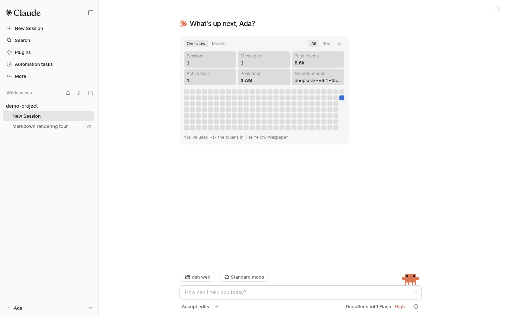
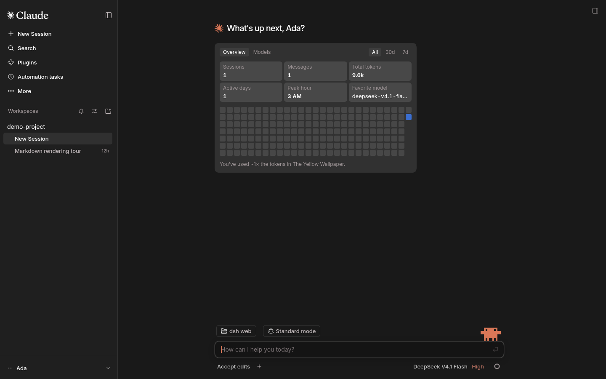
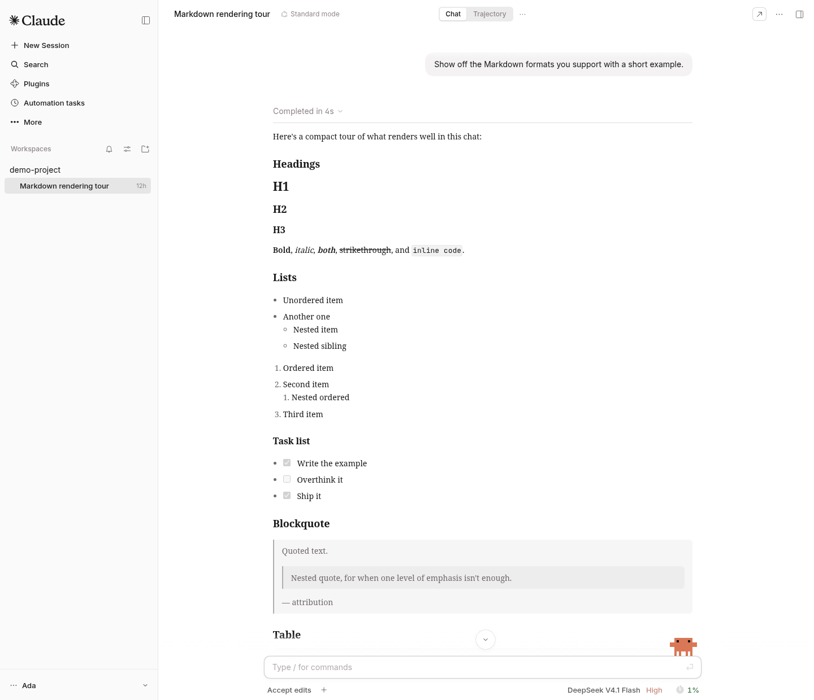
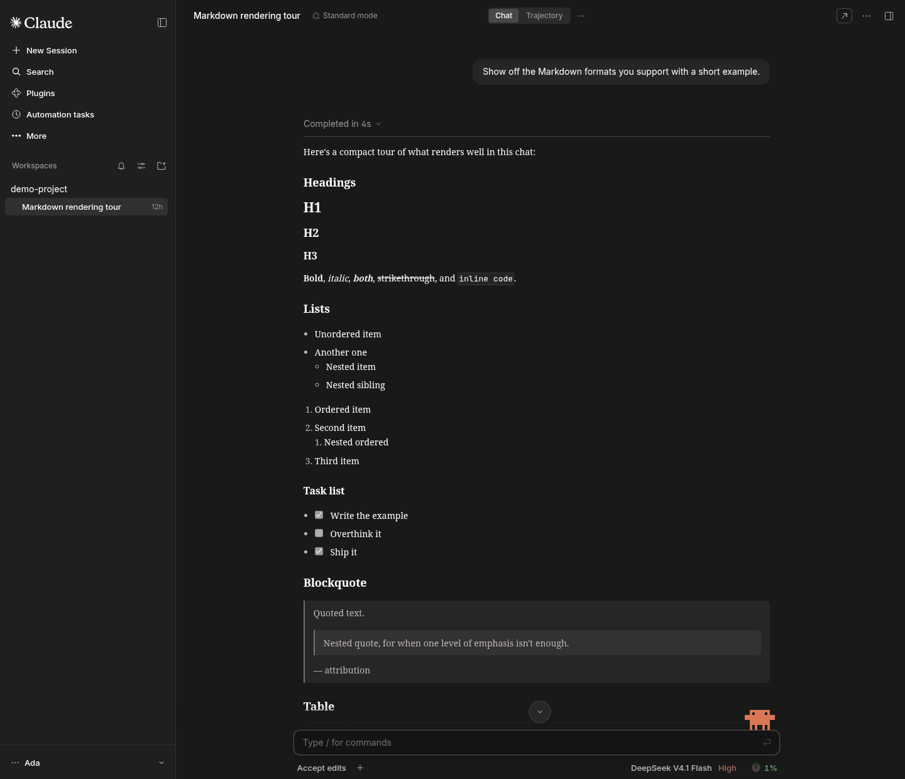
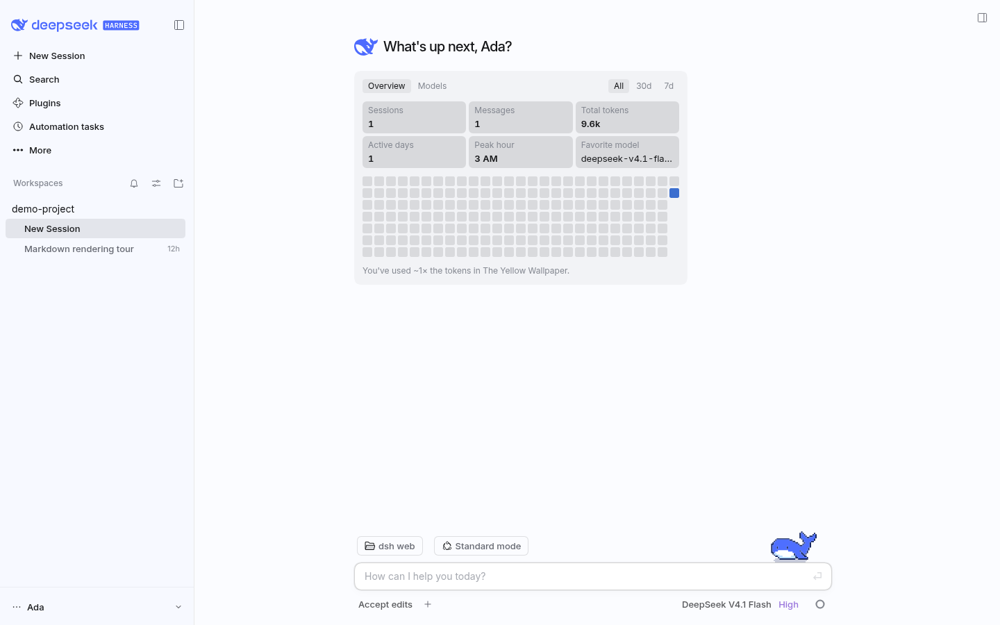
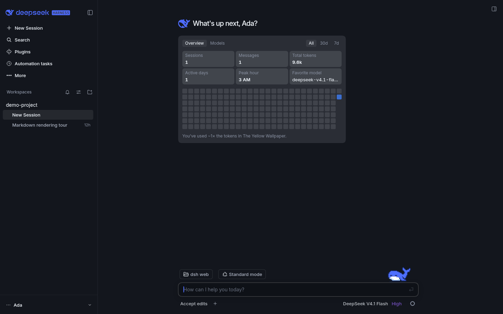
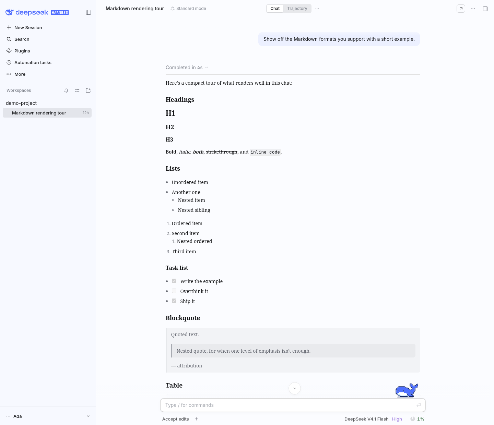
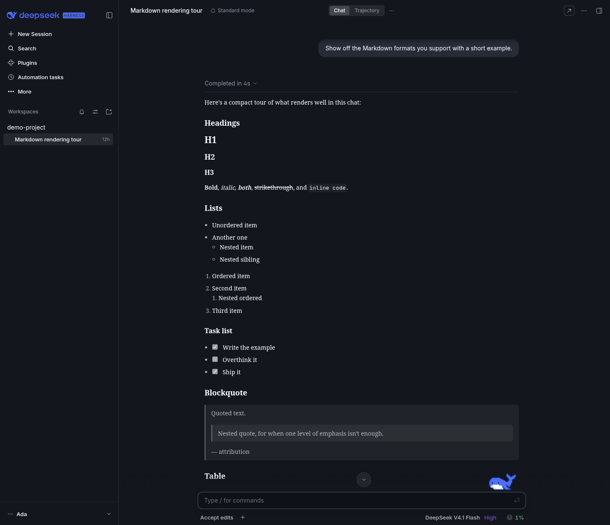

<div align="center">

# DSH Claude Style

**为 DeepSeek Harness 复刻 Claude Code Desktop 风格与交互体验的主题插件。**

> **你的下一个 Claude Code Desktop ，何必是Claude Code。**

[](README.zh.md) [](README.md)

[](https://github.com/martintondel02/dsh-claude-style-en/releases)
[](https://github.com/martintondel02/dsh-claude-style-en)
[](https://www.npmjs.com/package/@deepseek-ai/dsh)
[](LICENSE)

</div>

> **英文版。** 这是 [Nwflower/dsh-claude-style](https://github.com/Nwflower/dsh-claude-style) 的英文优先分支，已同步到上游 v0.20.1，并在 DeepSeek Harness 0.2.2-rc.1 上验证。插件界面文案本来就同时提供中英文，跟随 Harness 的界面语言；本分支把 README、指南和架构记录的默认语言改为英文，并翻译了源码注释。中文界面照旧可用：把 Harness 的界面语言切到 `zh` 即可。英文说明见 [README.md](README.md)。

## 预览

两套主题在插件设置里切换，亮暗跟随系统。

### Claude

<table>
  <tr>
    <td align="center" width="50%"></td>
    <td align="center" width="50%"></td>
  </tr>
  <tr>
    <td align="center" width="50%"></td>
    <td align="center" width="50%"></td>
  </tr>
</table>

> 编程首页（上），对话界面（下）；浅色在左，深色在右。

### DeepSeek

<table>
  <tr>
    <td align="center" width="50%"></td>
    <td align="center" width="50%"></td>
  </tr>
  <tr>
    <td align="center" width="50%"></td>
    <td align="center" width="50%"></td>
  </tr>
</table>

> 输入框上沿站着宠物小鲸鱼 Deepy，八个状态：

<table>
  <tr>
    <td align="center" width="25%"><br />空闲</td>
    <td align="center" width="25%"><br />思考</td>
    <td align="center" width="25%"><br />写回答、调用工具</td>
    <td align="center" width="25%"><br />指挥子代理</td>
  </tr>
  <tr>
    <td align="center" width="25%"><br />等你操作</td>
    <td align="center" width="25%"><br />失败</td>
    <td align="center" width="25%"><br />完成</td>
    <td align="center" width="25%"><br />睡着</td>
  </tr>
</table>
## 安装

把本分支的发布分支装进 web profile：

```bash
dsh plugin --profile web add martintondel02/dsh-claude-style-en#dist
```

也可以克隆仓库，运行 `npm install && npm run build`，再安装本地目录：

```bash
dsh plugin --profile web add /path/to/dsh-claude-style-en
```

同一时刻只启用一个主题。插件需要 dsh ≥ 0.2.2-rc.1；装好后重启 DeepSeek Harness，完整功能才会加载。

包名仍是 `dsh-claude-style`，所以本分支可以直接替换上游包。想把这个分支的插件页与元数据也换过来，先移除已装的上游版本：

```bash
dsh plugin --profile web remove dsh-claude-style
```

## 字体

> Anthropic 没有公开发行这三款字体；本仓库只提供下载与研究的[副本](https://github.com/martintondel02/dsh-claude-style-en/tree/master/packages/assets/src/fonts/anthropic)。


启用时二选一：装进系统，或把 `.ttf` 复制到 `$DSH_HOME/dsh-claude-style/fonts/`。

## 文档

| 文档 | 说明 |
| --- | --- |
| [设计令牌](docs/STYLE.md) | 配色、字体、形状、动效与层级 |
| [架构](docs/ARCHITECTURE.md) | 仓库的形状、两个半边，以及跨过模块边界的约束 |
| [架构决策](docs/adr/README.md) | 每条方向一页：背景、决定、后果与重审条件 |
| [更新日志](docs/CHANGELOG.md) | 版本历史 |
| [贡献指南](CONTRIBUTING.md) | 构建、提交规范与回归工具 |

## 许可

除特别说明，本仓库以 MIT 授权。

钠（Sodium）渲染引擎以 [PolyForm Shield 1.0.0](packages/client/src/features/sodium/LICENSE) 授权。

## 鸣谢

- 原插件是 [Nwflower/dsh-claude-style](https://github.com/Nwflower/dsh-claude-style)；本英文版沿用它的设计与行为，只改变文档语言。
- 「钠 / Sodium」取名致敬 Minecraft 的 [Sodium](https://github.com/CaffeineMC/sodium) 渲染优化模组，本插件与它无关。
- 消息导航参考 SherUnlocked-4869 的 [dsh-plugin-msg-nav](https://github.com/SherUnlocked-4869/dsh-plugin-msg-nav)（MIT）。
- Deepy 和鲸鱼娘的动画帧图来自 calmly-eating-bugs（[@wp3171216237](https://github.com/wp3171216237)）绘制的主题包。
- 聊天区的增强动效改自 [dsh-chat-ux](https://github.com/alm-allen/dsh-chat-ux)（MIT）。
- Clawd是 Anthropic 的角色形象。本插件是非官方爱好者作品，与 Anthropic 没有关联。

## 友链

> 想把 Claude Code / Codex 等外部代理的会话历史导入 DSH 接着聊？推荐作者的另一个插件 [dsh-chat-import](https://github.com/Nwflower/dsh-chat-import)。

## Star History

[](https://star-history.com/#martintondel02/dsh-claude-style-en&Date)
